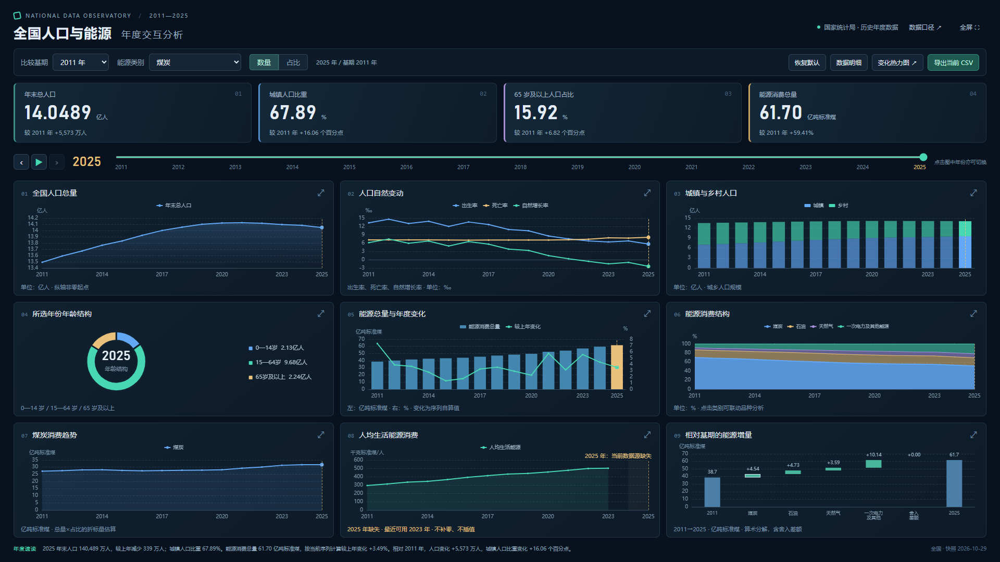
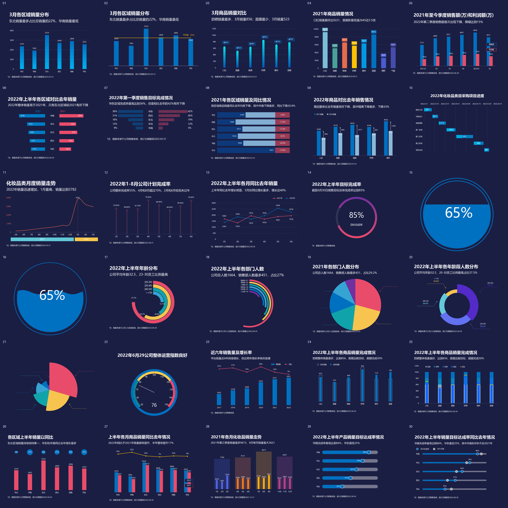
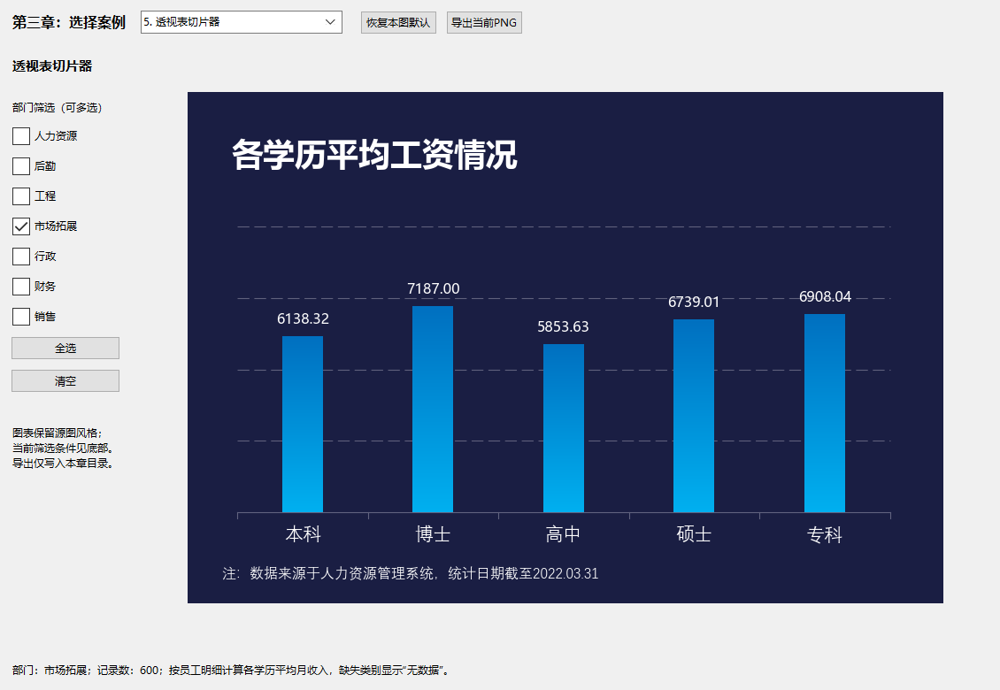
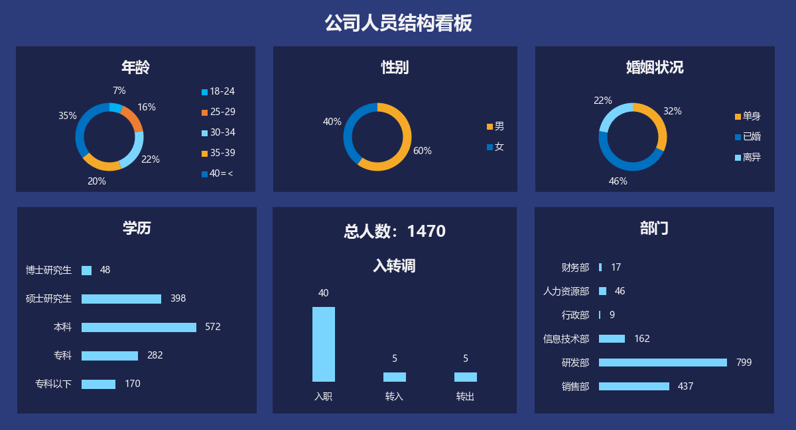
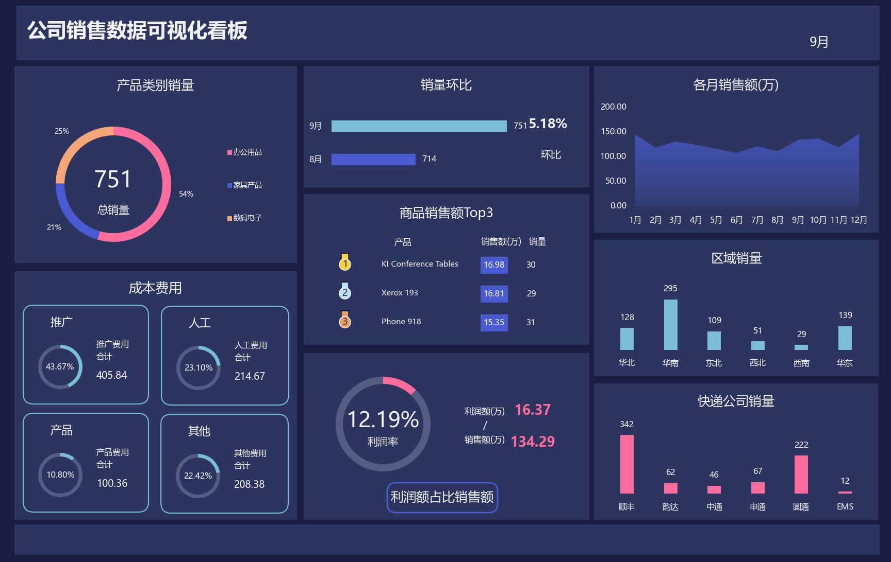

# Python 数据可视化｜从 Excel 图表到交互分析看板

用 Python 将 Excel 中的可视化案例转化为可运行程序，并进一步构建基于官方年度数据的交互分析看板。项目覆盖数据整理、指标计算、图表绘制、交互筛选和结果导出，提供代码、运行说明、效果截图与核验材料。

**30 个图表案例 · 7 个交互案例 · 2 个业务看板 · 1 个人口与能源交互看板**

第二至四章案例参考《Excel数据可视化——从图表到数据大屏》；人口与能源模块基于国家统计局公开数据独立设计。

## 人口与能源：15 年数据，10 张联动图表

从人口规模、城乡与年龄结构，到能源消费总量、品种结构和基期增量，在同一时间轴中观察 2011—2025 年的变化。主屏展示 9 张图，第 10 张热力图作为扩展分析视图。

[进入人口与能源项目 →](人口能源数据看板制作/README.md)



- **统一交互**：年份播放、图表点击、基期比较、能源选择与数量／占比切换；趋势图保留完整历史背景。
- **完整数据链路**：保留官方原始响应、指标字典、清洗 CSV、来源清单与校验值，使用 Python 和 SQLite 完成查询与计算。
- **可解释的统计口径**：区分数量、比例、百分点和序列变化；缺失数据明确标注，品种折标量注明估算方法。
- **本地运行与导出**：Python 标准库启动服务，浏览器呈现图表；随附 ECharts 资源，支持 PNG、CSV 和 JSON 导出。

## 模块导航

| 模块 | 数据／参考来源 | 实现成果 | 交互与输出 |
| --- | --- | --- | --- |
| [图表绘制](9.3第二章图复现/README.md) | 书籍第二章与工作簿 | 30 个图表案例 | 单图绘制、批量生成、原图对照 |
| [交互式图表](第三章动态图表/README.md) | 书籍第三章与工作簿 | 7 个动态图表案例 | 本地桌面筛选、状态切换、结果导出 |
| [业务可视化看板](第四章数据可视化看板/README.md) | 书籍第四章与工作簿 | 人力资源、销售 2 个看板，共 17 个组件 | 月份联动、原尺寸查看、图片与指标导出 |
| [人口与能源交互分析](人口能源数据看板制作/README.md) | 国家统计局全国年度数据 | 2011—2025 年、9 张主屏图与 1 张扩展图 | 本地浏览器、时间轴播放、基期比较、多图联动与导出 |

各模块均提供功能、运行、数据口径和验证说明，可按需要单独阅读与运行。

## Excel 案例成果

### 图表绘制

渐变柱形图、蝴蝶图、水球图、南丁格尔图等 30 个案例，提供 Python 结果与参考图对照。



### 交互式图表

通过下拉选择、指标勾选和部门筛选更新图表，保留各案例的独立选择状态。



### 业务可视化看板

将多个图表与指标卡片组合为人员结构和月度销售看板。





## 快速开始

下载或克隆完整仓库，以下命令均在仓库根目录执行：

```powershell
git clone https://github.com/1881188/big-data-analysis-and-visualization.git
cd big-data-analysis-and-visualization
```

### 人口与能源交互看板

Python 3.10 或以上及现代浏览器即可运行，无需安装 Python 第三方库或启动 Excel：

```powershell
python "人口能源数据看板制作/app.py"
```

程序自动打开浏览器，默认地址为 `http://127.0.0.1:8765/`。默认当前年为 2025、比较基期为 2011。按 Ctrl+C 关闭服务；端口占用时可追加 `--port 8766`。详细操作见[模块运行说明](人口能源数据看板制作/README.md#快速开始)。

### Excel 案例

推荐 Windows 桌面环境，已验证 Python 3.13。第三、四章需要 Tkinter，中文字体使用微软雅黑等；已有环境满足依赖时可跳过安装。

| 模块 | 安装依赖 | 启动／生成 |
| --- | --- | --- |
| 第二章 | `python -m pip install -r "9.3第二章图复现/requirements.txt"` | `python "9.3第二章图复现/运行全部30图.py"` |
| 第三章 | `python -m pip install -r "第三章动态图表/requirements.txt"` | `python "第三章动态图表/app.py"` |
| 第四章 | `python -m pip install -r "第四章数据可视化看板/requirements.txt"` | `python "第四章数据可视化看板/app.py"` |

保留源工作簿的文件名与目录关系。日常运行由 Python 读取数据并绘图，不执行 VBA 宏；重新导出 Excel 参考图的辅助工具需要 Windows 上的 Microsoft Excel。

## 技术实现

| 层次 | Excel 案例模块 | 人口与能源模块 |
| --- | --- | --- |
| 数据输入 | Excel 工作簿、openpyxl | 官方 JSON 快照、清洗 CSV |
| 数据计算 | Python、NumPy | Python 标准库、SQLite 参数化查询 |
| 图表绘制 | Matplotlib | Apache ECharts 5.6.0 |
| 交互界面 | Tkinter 桌面窗口 | HTML、CSS、JavaScript 与本地 Python HTTP 服务 |
| 结果交付 | 图表、对照图、筛选结果 | 交互看板、PNG、CSV、JSON 与数据核验材料 |

人口与能源模块的获取、清洗、查询、交互和导出流程见[实现架构](人口能源数据看板制作/README.md#实现架构)。

## 数据与验证

Excel 案例按原图核对数据、配色、标签和布局；交互模块检查筛选状态与导出，业务看板检查全年月份聚合与组件渲染。字体和部分细节可能与参考图存在差异，具体口径修正在各模块中说明。

人口与能源模块保留 40 项原始指标及来源记录，当前展示 2011—2025 年。**2024、2025 年的人均生活用能在当前数据源中缺失**，对应图表保留空值并明确提示，其他已有指标正常显示。7 组后端测试覆盖 960 种有效筛选组合；15 项浏览器检查覆盖真实点击、年份播放、数据导出及多尺寸布局，10 张图均已逐图检查。

- [人口与能源数据说明](人口能源数据看板制作/数据说明.md)
- [数据核验报告](人口能源数据看板制作/数据核验报告.md)
- [看板检查与验收记录](人口能源数据看板制作/看板验收记录.md)
- [项目介绍与演示提纲](人口能源数据看板制作/项目介绍.md)

当前功能使用保存的数据快照；年份播放表示历史数据切换。各模块的运行平台和验证范围见对应 README。

## 项目结构

```text
big-data-analysis-and-visualization/
├── README.md                     # 项目入口与模块导航
├── ABOUT.md                      # GitHub 简介与主题词
├── 9.3第二章图复现/               # 30 图代码、工作簿与对照材料
├── 第三章动态图表/               # 7 个桌面交互案例
├── 第四章数据可视化看板/         # 人力资源与销售看板
├── 人口能源数据看板制作/         # 官方数据与浏览器交互看板
├── 第三章 动态图表.xlsm
├── 第四章 人力资源可视化看板.xlsx
└── 第四章 销售看板参考.xlsx
```

## 参考与来源

Excel 案例参考《Excel数据可视化——从图表到数据大屏》第二至四章及相应工作簿。书籍案例设计、原始数据与参考素材的权利归原作者或相应权利人所有；仓库公开不代表授予这些素材的再分发许可。

人口与能源数据来自[国家统计局国家数据·全国年度数据](https://data.stats.gov.cn/dg/website/page.html#/pc/national/yearData)，本次快照获取日期为 2026-10-29。引用整理结果时请保留来源、时间与统计口径。随附 ECharts 的许可证与 NOTICE 保存在[第三方资源目录](人口能源数据看板制作/web/vendor/)。
