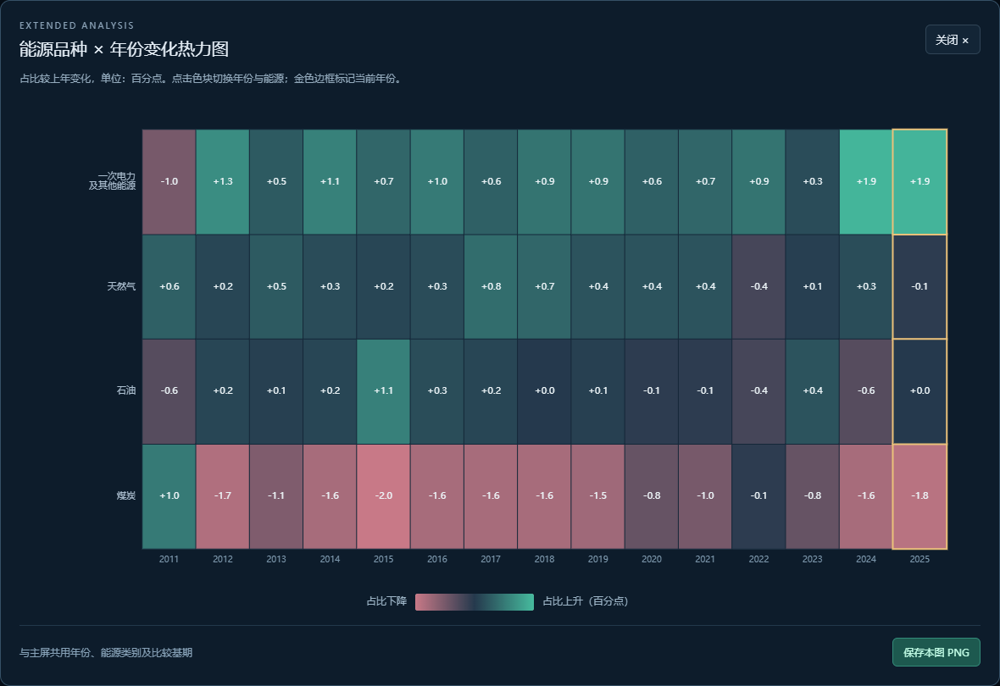
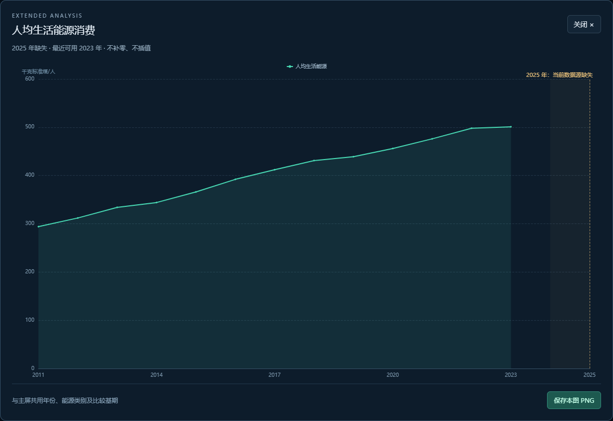
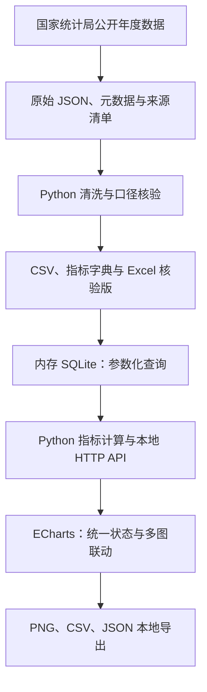

# 全国人口与能源交互分析看板

[返回仓库首页](../README.md) · [数据说明](数据说明.md) · [检查与验收](看板验收记录.md) · [项目介绍](项目介绍.md)

基于国家统计局公开年度数据，使用 **Python + SQLite + Apache ECharts** 构建本地浏览器交互看板。从人口规模、城乡与年龄结构，到能源总量、品种结构与基期增量，用统一时间轴探索全国 15 年的变化。

**2011—2025 年 · 9 张主屏图 + 1 张扩展图 · 历史年份播放 · 多图联动 · 本地导出**


> 默认显示 2025 年，与 2011 年比较。2024、2025 年的人口和能源已有数据正常显示；人均生活用能在当前数据源中缺失，对应图表明确提示并保留空值。

## 项目亮点

| 能力 | 实现内容 |
| --- | --- |
| 官方数据整理 | 保存 6 组数据响应、40 项原始指标、指标元数据与来源校验清单，提供 CSV 和 Excel 核验版 |
| 统一交互状态 | 年份、比较基期、能源类别和显示模式共同驱动相关图表，趋势始终保留完整历史 |
| 多图联动分析 | 点击人口数据点切换年份，点击能源结构或热力图联动年份与品种 |
| 可解释的指标计算 | 使用 SQL 查询与 Python 计算，区分数量、比例和百分点，单列估算值与舍入差额 |
| 本地展示与导出 | 标准库启动服务，随附固定版本图表资源，支持全屏、单图放大、明细和 PNG／CSV／JSON 导出 |
| 可复查的交付 | 提供逐图截图、7 组后端测试、15 项浏览器检查及数据核验报告 |

## 快速开始

### 启动看板

需要 Python 3.10 或以上及现代浏览器。已验证 Windows、Python 3.13 与 Microsoft Edge。看板运行仅使用 Python 标准库，无需安装 Python 第三方依赖或启动 Excel；ECharts 5.6.0 已随项目保存，无需访问 CDN。

在**仓库根目录**运行：

```powershell
python "人口能源数据看板制作/app.py"
```

程序自动打开浏览器，默认地址为 `http://127.0.0.1:8765/`。按 Ctrl+C 关闭服务，关闭后重新运行上述命令即可再次查看。

也可以进入本模块后运行 `python app.py`。端口占用或不希望自动打开浏览器时：

```powershell
python "人口能源数据看板制作/app.py" --port 8766 --no-browser
```

使用备用端口时，在浏览器打开 `http://127.0.0.1:8766/`。服务绑定本机回环地址；当前仓库提供本地运行版本。

### 操作方式

| 控件／操作 | 行为 |
| --- | --- |
| 年份时间轴、前后切换 | 更新当年指标、结构图与明细，趋势图同步高亮选中年 |
| 播放／暂停 | 按历史年度逐年切换 |
| 比较基期 | 计算当前年相对基期的数量变化、百分点变化与能源增量 |
| 能源类别 | 更新所选品种趋势及相关明细，保留人口分析 |
| 数量／占比 | 切换城乡结构、年龄图例与所选能源趋势的适用显示方式 |
| 图表悬停／点击 | 悬停查看数值；点击支持联动的图表确定年份或品种 |
| 图卡右上角放大／全屏 | 查看单图细节或展示整屏 |
| 数据明细 | 查看当前年或完整 15 年数据，并保存 CSV／JSON |
| 恢复默认 | 回到 2025 年、基期 2011 年、煤炭、数量模式 |

基期不得晚于当前年；切换到更早年份时，基期自动调整到合法范围。所有趋势图保留 15 年背景。

导出文件统一保存在本模块 `outputs/dashboard/exports/`，文件名含筛选条件和时间戳，不覆盖已有结果。该目录默认不纳入 Git。

## 图表与分析问题

| 编号 | 图表 | 回答的问题 | 对应交互 |
| --- | --- | --- | --- |
| 01 | 全国人口总量趋势 | 人口规模在哪些年份出现转折？ | 点击年份，高亮当前年 |
| 02 | 人口自然变动 | 出生率、死亡率和自然增长率如何变化？ | 三条完整趋势，联动年份 |
| 03 | 城镇与乡村人口 | 城乡人口规模与比例如何变化？ | 数量／占比、点击年份 |
| 04 | 所选年份年龄结构 | 当年人口的年龄构成是什么样？ | 随年份更新，图例支持人数／占比 |
| 05 | 能源总量与年度变化 | 消费规模和较上年变化如何变化？ | 总量柱形与变化折线，联动年份 |
| 06 | 能源消费结构 | 四类能源占比如何变化？ | 点击面积区域选择年份与品种 |
| 07 | 所选能源消费趋势 | 占比变化时，折标规模是否同向变化？ | 品种选择、折标量估算／占比 |
| 08 | 人均生活能源消费 | 生活用能水平如何变化？ | 年份联动、缺失区与最近可用年提示 |
| 09 | 相对基期的能源增量 | 各品种对应多少增减量？ | 基期比较、算术分解与舍入项 |
| 10 | 能源品种 × 年份变化热力图 | 哪些品种、哪些年份占比变化明显？ | 扩展视图，点击色块联动 |

第 6 张图观察结构，第 7 张图观察所选品种的折标规模。指标卡和明细表不计入 10 张图。

<details>
<summary>查看扩展热力图与缺失值处理效果</summary>





</details>

## 实现架构



数据获取与清洗属于准备阶段。日常打开看板直接使用随项目保存的 CSV，在内存中建立 SQLite 表，不重新请求官方接口。年度速读由固定计算规则生成。

| 文件 | 责任 |
| --- | --- |
| [dashboard_data.py](dashboard_data.py) | CSV 加载、SQL 查询、基期比较、完整趋势、瀑布分解和导出数据 |
| [app.py](app.py) | 本地 HTTP 服务、参数校验、静态页面和导出保存 |
| [web/dashboard.js](web/dashboard.js) | 统一筛选状态、图表更新、播放与点击联动 |
| [web/styles.css](web/styles.css) | 主屏与不同窗口尺寸布局 |
| [sql/analysis.sql](sql/analysis.sql) | 年度查询、结构变化与基期分解示例 |

接口 `/api/data` 返回当前状态与完整历史，`/api/save` 将导出保存到模块内指定目录。正常运行不改写原始与清洗数据。

## 数据范围与统计口径

数据来自[国家统计局国家数据·全国年度数据](https://data.stats.gov.cn/dg/website/page.html#/pc/national/yearData)。本次快照获取日期为 **2026-10-29**，数据范围与获取时间分别记录。

| 项目 | 说明 |
| --- | --- |
| 原始查询范围 | 2008—2025 年，共 18 年、40 项原始指标 |
| 看板展示范围 | 2011—2025 年，共 15 年；2010 年用于首年同比辅助 |
| 地区 | 全国 |
| 人口与能源核心数据 | 总量、城乡、年龄、自然变动、能源总量及结构已有值至 2025 年 |
| 人均生活能源 | 本次数据源有值至 2023 年，2024、2025 年为空 |
| 来源追溯 | 原始响应、指标 ID、定义、获取时间与 SHA-256 校验值随项目保存 |

人均生活用能缺失时，图表保留曲线断点、缺失区和提示；明细显示“—”，CSV 保留空单元格，JSON 保留 `null`。未取得可核验补充原表的数值不拼接进当前快照。

关键计算约定：

- 人口为年末时点数，年龄统一为 0—14 岁、15—64 岁、65 岁及以上；城镇人口比重和年龄占比由人数计算。
- 能源品种保留官方名称：煤炭、石油、天然气、一次电力及其他能源。
- **品种折标量估算 = 总量 × 官方占比 ÷ 100**，使用标准煤口径，不能理解为实物煤炭吨数或天然气体积。
- 能源年度变化按当前总量序列计算，与官方可比口径增速区分。
- 占比变化使用百分点，数量增长率使用百分比，出生率等使用 ‰。
- 瀑布图表示基期增量的算术分解，单列舍入差额，不据此推断因果贡献。
- 人均生活能源直接使用官方指标，不以全国总能源除以年末人口替代。

2018 年年龄分组合计比总人口少 1 万人、2019 年能源占比合计 99.9%，均保留原值并提示。原 CSV 的 `in_display_window` 是初次核验的 2009—2023 年完整窗口标记，当前看板按年份查询，不用该历史标记筛选。

字段、算法、原始下载和重新整理步骤见[数据说明](数据说明.md)，核对结果见[数据核验报告](数据核验报告.md)。

## 验证与展示范围

本版本已于 **2026-10-29 通过用户整体验收**。10 张图均已单独打开，检查数据、单位、标签、图例与布局，材料见[看板验收记录](看板验收记录.md)。

| 检查层次 | 已完成验证 |
| --- | --- |
| 后端 | 7 组测试；960 种有效筛选组合；参数约束、缺失传播、导出、HTTP 与舍入分解 |
| 数据保护 | 测试前后原始及清洗数据哈希一致 |
| 浏览器 | 15 项检查；全部 15 年切换、实际图表点击、播放、基期、全屏与导出 |
| 窗口布局 | 1920×1080、1366×768 和 390 像素窄屏；未验证真实手机触摸操作 |
| 图表资源 | 浏览器检查无脚本错误、无外部资源请求 |

在仓库根目录运行后端测试：

```powershell
python "人口能源数据看板制作/tests/test_dashboard.py"
```

浏览器检查脚本为 [test_browser.mjs](scripts/test_browser.mjs)，截图脚本为 [preview_dashboard.mjs](scripts/preview_dashboard.mjs)。两者需要 Node.js、Playwright 与已安装的 Microsoft Edge，并要求本地看板服务使用 8765 端口；浏览器可执行文件路径在脚本中指定，其他环境需调整。这些工具不属于看板日常运行依赖。

主设计尺寸为 1920×1080。小窗口纵向滚动，窄屏改为单列；人口总量图采用非零纵轴并在图下注明。精确值可通过悬停与数据明细查看。

## 文件导航

```text
人口能源数据看板制作/
├── app.py                       # 本地服务入口
├── dashboard_data.py            # Python / SQLite 查询与计算
├── web/                         # 页面、交互、样式与随附图表资源
├── data/
│   ├── raw/                     # 官方响应与来源快照
│   └── processed/               # 清洗 CSV、指标字典与核验结果
├── sql/analysis.sql             # 分析查询示例
├── scripts/                     # 下载、清洗、核验与浏览器检查
├── tests/test_dashboard.py      # 后端测试
├── outputs/
│   ├── data-review/             # Excel 核验版与逐表预览
│   └── dashboard/               # 看板、逐图与交互检查截图
├── 项目介绍.md                  # 对外介绍与演示提纲
├── 数据说明.md                  # 来源、字段、算法与复现步骤
├── 数据核验报告.md              # 数据阶段核验记录
└── 看板验收记录.md              # 逐图、交互与用户验收
```

## 来源与第三方资源

本模块的数据来源为国家统计局，整理结果保留来源、获取日期与指标口径。它与仓库内参考书籍的 Excel 复现模块分别说明数据来源。

Apache ECharts 5.6.0 的[许可证](web/vendor/ECHARTS-LICENSE.txt)、[NOTICE](web/vendor/ECHARTS-NOTICE.txt)与[资源校验清单](web/vendor/manifest.json)随资源保存。重新获取固定版本资源可运行 `scripts/fetch_chart_assets.py`。
